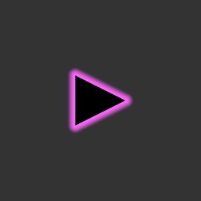
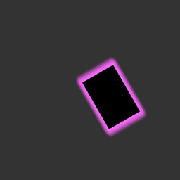
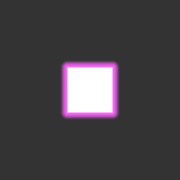
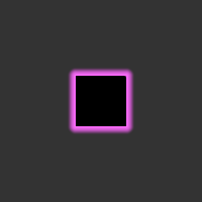
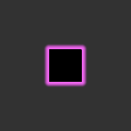

# 연속 감쇠 Glow / 씬·게임 출력 검증

2026-11-04, Unity 6000.0.32f1 / Direct3D 11 / RTX 4070 Ti의 별도 Built-in 프로젝트에서 실행했습니다. 본 프로젝트와 같은 **Linear 색 공간**이며, 17개 테스트 모두 통과했습니다. 실패·건너뜀은 0개입니다.

## 수정

- 폴리곤/단색 Image는 실루엣을 반복해서 겹치지 않고 실제 외곽선까지의 거리를 계산합니다.
- 로컬 좌표를 UV1로 전달해 Canvas 배칭과 이동·회전·배율에도 도형이 맞도록 했습니다.
- 바깥 경계에서 값과 기울기가 0으로 줄어드는 연속 감쇠를 사용합니다.
- 기본 출력은 SDR로 제한하며 실제 HDR이 필요하면 머터리얼에서 켤 수 있습니다.
- 씬뷰 후처리를 게임 Overlay UI 기준으로 끄는 명시적인 미리보기 버튼을 제공합니다. 작업 씬이나 게임 카메라 설정은 변경하지 않았습니다.

## 실제 픽셀 검사

폴리곤 경계에서 바깥으로 읽은 빨강 채널:

`0.7259 → 0.6081 → 0.4669 → 0.3262 → 0.2078 → 0.1117 → 0.0579 → 0.0379 → 0.0334 → 0.0331 → 0.0331`

마지막 값은 배경과 같습니다. 감쇠는 단조롭고 외곽에서 갑자기 끊기지 않는 것을 검사했습니다. HDR float 타깃과 일반 8bit linear 타깃은 픽셀별 RGB 차이 0.012 미만, 후처리 없는 Game/SceneView 카메라 유형은 0.005 미만으로 통과했습니다.

PNG는 Linear GPU 리드백을 디스플레이용 sRGB로 변환해 저장했습니다. 실제 GameView/SceneView 편집기 창을 캡처한 것은 아니며, 같은 조건의 테스트 카메라 출력입니다. 사용자의 실제 씬뷰에 별도 노출/후처리 효과가 켜진 경우에는 미리보기 버튼으로 해당 차이를 제거해야 합니다.

## 캡처

### 같은 조건의 Game / SceneView 카메라

### HDR / 일반 타깃

## 검증 범위

Image·폴리곤의 기본 가시성, 삼각형 꼭짓점 이동, Mask/RectMask2D, 알파/UV 보존, 비활성화, 스텐실 값 보존, 중복 Glow 방지, 연속 감쇠, 출력 일치 및 Canvas 변환을 검사했습니다. 컷인처럼 도형이 처음에 0 크기였다가 펼쳐지는 상황에서 렌더 재질이 정확히 연결되는 회귀 테스트도 통과했습니다. 실제 URP 로비 씬의 재생/편집기 후처리 설정을 자동 변경하거나 직접 검증하지 않았습니다.

전체 [NUnit 결과](GlowTests.xml).
