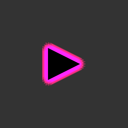
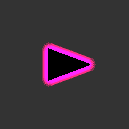
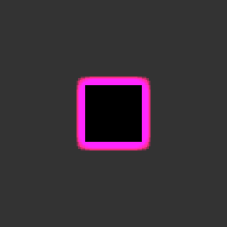

# UI Glow 실제 GPU 검증

사용자 승인 후 별도 임시 프로젝트에서 Unity Test Runner를 실행했습니다. 현재 작업 프로젝트의 씬/프리팹이나 열려 있는 편집기는 변경하지 않았습니다.

- Unity: 6000.0.32f1
- GPU: NVIDIA GeForce RTX 4070 Ti / Direct3D 11.0, feature level 11.1
- 테스트: 12개 통과, 실패 0, 건너뜀 0
- 기본 머터리얼: Intensity 3, Brightness 3, Radius 12, Falloff 1.2
- 파이프라인: 별도 Built-in 테스트 프로젝트, Screen Space Camera Canvas → HDR RenderTexture → GPU 픽셀 리드백

## 가시성

도형 경계 밖의 배경 픽셀은 RGBA(0.200, 0.200, 0.200, 1.000)이었고, 기본 Glow를 켜면 Image와 커스텀 폴리곤 모두 RGBA(2.672, 0.156, 1.083, 1.000)이었습니다. 원본 검은 도형의 중앙은 RGBA(0.000, 0.000, 0.000, 1.000)으로 유지됐습니다. 이 값은 계산식 추정이 아니라 카메라 렌더 결과를 실제 읽어 얻었습니다.

삼각형의 직선 경계는 RGBA(2.672, 0.156, 1.083, 1.000), 꼭짓점 바깥은 RGBA(1.081, 0.184, 0.515, 1.000)으로 발광을 확인했습니다. 꼭짓점 이동 후 이전 위치는 원본 도형에 덮여 검은색이 됐고, 이동한 끝 위치에서 같은 발광 픽셀을 확인했습니다.

PNG는 GPU 캡처를 그대로 저장한 것입니다. HDR의 1 초과 값은 PNG에서 1로 제한되며, 별도의 Bloom/후처리는 사용하지 않았습니다.

### 삼각형 폴리곤

### 꼭짓점 이동 후

### Image / 사각형 폴리곤

### 마스크

Mask와 RectMask2D 모두 마스크 안의 발광 픽셀은 유지하고 바깥은 원래 배경 색으로 잘리는 것을 확인했습니다. 폴리곤의 머터리얼만으로 생성되는 자동 Glow, UIGlow를 추가할 때 중복 생성하지 않는 처리, 효과 비활성화, Atlas UV/원본 알파 보존, 스텐실 재질 값 보존도 통과했습니다.

전체 기계 판독 결과: [GlowTests.xml](GlowTests.xml).

이 검증은 별도 프로젝트에서 UI 셰이더와 렌더 경로를 확인한 것이며, 사용자가 편집 중인 로비의 배치/애니메이션/URP 합성 화면을 직접 확인한 것은 아닙니다.
